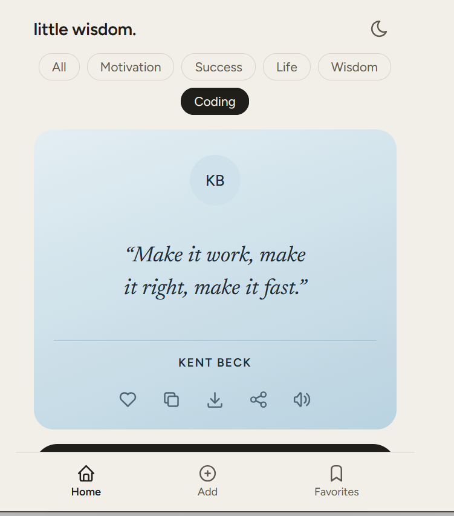
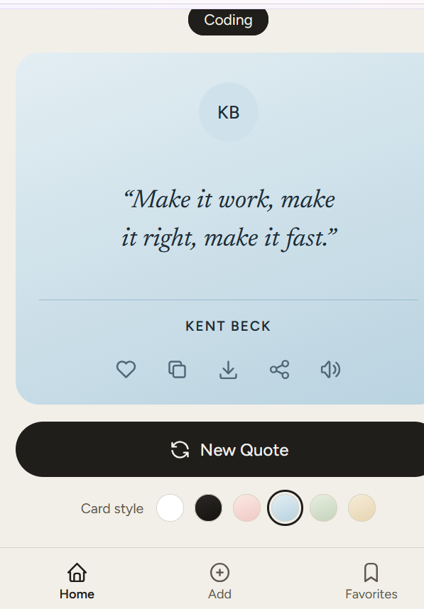
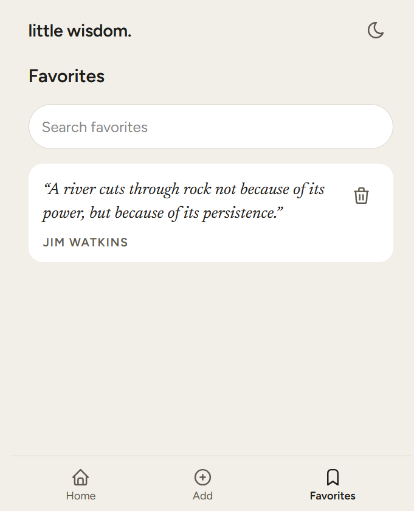
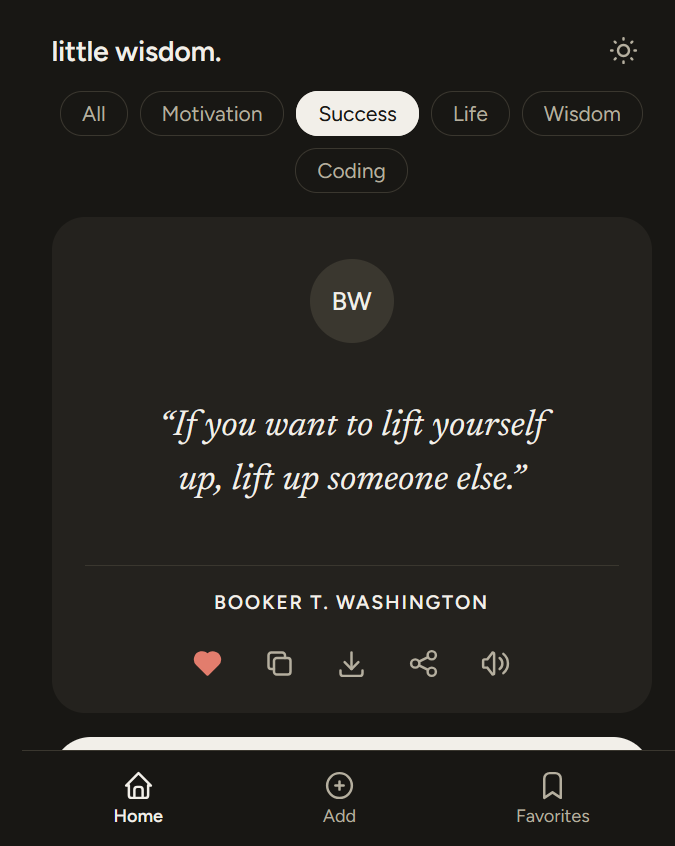

# CodeAlpha_RandomQuoteGenerator

**little wisdom.** is a minimal, installable random quote app built with HTML, CSS and vanilla JavaScript.
Built for the CodeAlpha App Development Internship (Task 2).

Live demo: https://wafa-yazeer.github.io/CodeAlpha_RandomQuoteGenerator/

## Required features
- A random quote appears every time the app opens
- "New Quote" button shows a different quote on each click (never the same one twice in a row)
- Quote text and author name are clearly displayed
- Clean, minimal UI

## Extra features
- **84 quotes** in 5 categories (Motivation, Success, Life, Wisdom, Coding) with a category filter
- **Download as image**: turns any quote into a 1080x1350 PNG, ready to post
- **Share**: shares the quote image on phones (Web Share API), copies the text elsewhere
- **Card styles**: Classic, Midnight, Blush, Ocean, Sage and Paper (used in the app and the downloaded image)
- **Favorites** with search, saved in the browser
- **Add your own quotes** (and delete them later); they join the random mix
- **Read aloud** using the browser's speech synthesis
- **Light and dark mode**, remembers your choice
- **Installable PWA** that also works offline (manifest + service worker)
- Responsive, mobile-first layout with keyboard focus styles and reduced-motion support

## Run it
1. Download or clone this repository.
2. Open it in VS Code and start **Live Server** on `index.html`
   (or double-click `index.html`; install and offline mode need `http://` or `https://`).

No build step or dependencies.

## Install as an app
- **Android / desktop Chrome or Edge:** use the **Install app** button in the header, or the browser's install option.
- **iPhone:** open the live link in Safari, tap Share, then **Add to Home Screen**.

## Deploy with GitHub Pages
1. Push the project files to the root of the repository.
2. Repository **Settings > Pages**, set Source to **Deploy from a branch**, branch **main**, folder **/ (root)**.
3. Open the link GitHub shows after a minute.

## Project structure
```
index.html              page structure and icons
style.css               theme, card styles, layout
script.js               quotes, random logic, favorites, canvas image, share, PWA install
manifest.webmanifest    app name, colors and icons
sw.js                   service worker (offline cache)
icons/                  app icons
```

## How it works
- **Random quote:** picks a random item from the filtered list and re-picks if it matches the last one.
- **Storage:** favorites, your quotes and settings are saved with `localStorage`.
- **Image download:** the quote is drawn on an HTML canvas using the current card style, then saved with `toBlob`.
- **Offline:** `sw.js` caches the app files. Change `CACHE_NAME` in it whenever you edit the app so installed copies update.

## Screenshots
| Home | Card styles | Downloaded image | Favorites | Dark mode |
|---|---|---|---|---|
|  |  |  |  |  |
## Tech
HTML5, CSS3, JavaScript, Canvas API, Web Share API, Web Speech API, Service Worker, localStorage
